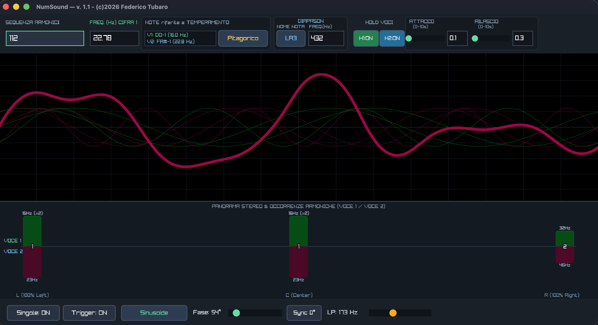

# NumSound — Harmonic Sequence Synthesizer & Stereo Panorama (v1.1)
 

**NumSound** è un sintetizzatore additivo e analizzatore acustico in tempo reale progettato per esplorare le sequenze di armonici naturali, la spazializzazione stereo, i temperamenti storici/matematici, i fenomeni di battimento tra due voci e la corrispondenza fisica tra i toni musicali e i toni luminosi che vibrano a 34 ottave più in alto, scoprendo che il rosso è un SOL, il verde è un DO, il giallo è un LA. Il sintetizzatore riceve segnali MIDI e può essere suonato in tempo reale.

**NumSound** is a real-time additive synthesizer and acoustic analyzer designed to explore natural harmonic series, stereo panorama distribution, historical/mathematical temperaments, and beating phenomena between two voices and to explore the physical correspondence between musical tones and light tones that vibrate 34 octaves higher, discovering that red is a G, green is a C, and yellow is an A. The synthesizer receives MIDI and can be played in real time.

---

## Caratteristiche Principali / Key Features

* **Sequenze di Armonici Naturali (1–9) / Natural Harmonic Sequences (1–9):**
  * Genera in tempo reale multipli interi della frequenza fondamentale (\(1f, 2f, \dots, 9f\)) distribuendo automaticamente ciascuna armonica lungo il panorama stereo da Sinistra (L) a Destra (R).
  * Generates real-time integer multiples of the fundamental frequency (\(1f, 2f, \dots, 9f\)), automatically panning each harmonic across the stereo field from Left (L) to Right (R).
* **Polifonia a 2 Voci (Duofonia) & Inviluppo AR / 2-Voice Polyphony & AR Envelope:**
  * Supporto a due voci indipendenti con controlli **H1 / H2 (Hold)** separati per bloccare un bordone e suonare intervalli sulla seconda voce.
  * Inviluppo **Attacco / Rilascio (0.0 – 10.0s)** regolabile via slider e inserimento numerico diretto.
* **4 Temperamenti & Diapason Configurabile / 4 Temperaments & Custom Diapason:**
  * Commutazione istantanea tra **Pitagorico**, **Equabile**, **Vincenzo Galilei** (\(18/17\)) e **Mesotonico** (*Quarter-comma meantone*).
  * Riferimento diapason regolabile su **DO3** (es. `256 Hz`) o **LA3** (es. `432 Hz` / `440 Hz`), con riconoscimento in tempo reale delle note suonate (`V1` e `V2`).
* **Oscilloscopio & Spettro Stereo Speculare / Oscilloscope & Mirrored Stereo Spectrum:**
  * Oscilloscopio con **Schmitt Trigger**, visualizzazione delle singole armoniche colorate per frequenza/ottava, controllo continuo di **sfasamento** (`0°–360°`), **Sync 0°** e filtro **Low-Pass 12 dB/oct**.
  * Spettro stereo speculare con **Voce 1** (verso l'alto) e **Voce 2** (verso il basso) modulate dall'inviluppo in tempo reale.
* **Supporto MIDI Nativo / Native MIDI Support:**
  * Ricezione note (`NOTE_ON` / `NOTE_OFF`) e controllo filtro Low-Pass (`CC 7`) tramite tastiere e controller MIDI (`CoreMIDI` con hot-plug su macOS, `WinMM` su Windows, `javax.sound.midi` nella versione Java).

---

## Struttura del Progetto / Project Structure

* `cpp/` — Versione nativa ad alte prestazioni in **C++** (basata su **raylib** e **miniaudio**), compilabile per **macOS** e **Windows**.
* `java/` — Versione multipiattaforma in **Java (Swing)** senza dipendenze esterne.

---

## Compilazione ed Esecuzione / Build & Run

### Versione C++ (Consigliata / Recommended)
Richiede `raylib` e un compilatore C++17 (`clang++` su macOS, `MinGW-w64` per cross-compilazione Windows).

```bash
cd cpp
./build_all.sh
```
Gli eseguibili vengono generati in `cpp/build/mac/` e `cpp/build/win/`.

### Versione Java
Richiede JDK 11 o superiore:

```bash
cd java
./build.sh
```

---

## Licenza / License

Copyright (c) 2026 **Federico Tubaro**  
Distribuito sotto licenza **PolyForm Noncommercial 1.0.0** (`SPDX-License-Identifier: PolyForm-Noncommercial-1.0.0`).
